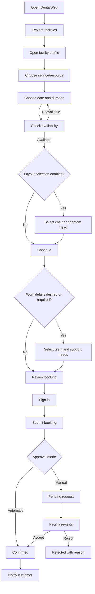
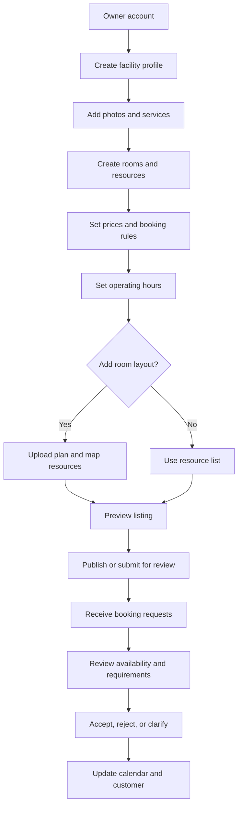
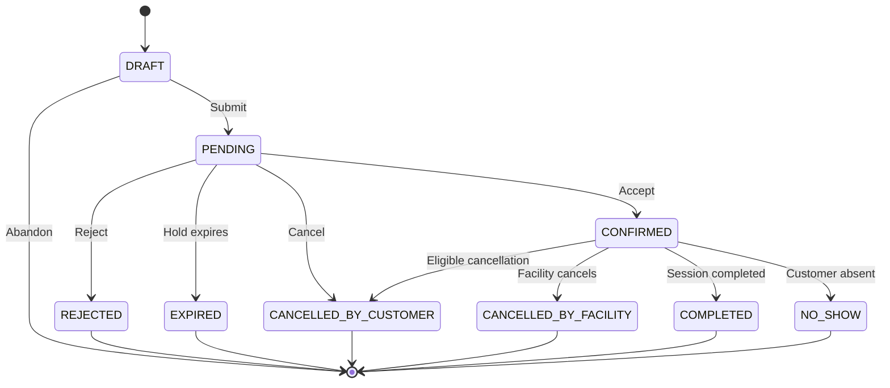
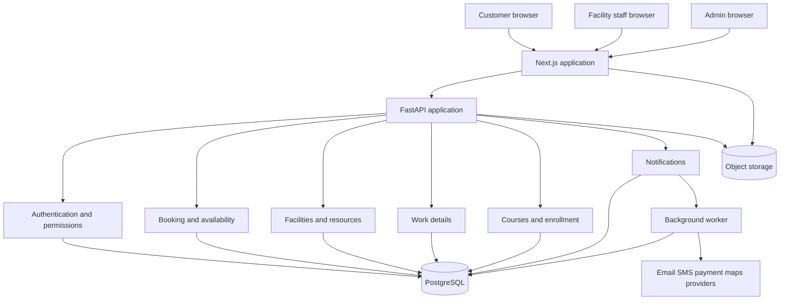
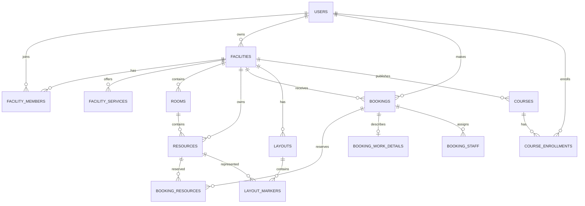

# DentalWeb — Product Requirements & Software Architecture Specification

Version: 1.0  
Date: 10 November 2026  
Repository: https://github.com/BasantAwad/DentalWeb  
Status: Initial product specification; validate open business rules before production implementation.

## 1. Executive summary

DentalWeb is a marketplace and facility-management platform for dental practice and training facilities. It connects dental students and dentists with places that rent phantom heads, dental chairs, operatories, workstations, rooms, and equipment. Facilities can also promote courses and practical workshops.

This is not just a directory with a calendar. The distinguishing experience is visual and interactive:
- Customers discover facilities, inspect their services and equipment, check availability, and reserve a resource.
- Where supported, customers select a specific phantom-head station or chair from an interactive room plan or 3D room.
- Customers can optionally declare the intended dental work using an interactive 3D dental model and select individual teeth.
- Customers can request an assistant or a facility-provided dentist where offered.
- Facility owners manage resources, schedules, reservations, staff, courses, and their public profile through a responsive dashboard.

The system is a booking and marketplace product, not a diagnostic tool, treatment-planning system, medical records system, or substitute for clinical judgement. Tooth selection records customer-declared session requirements only.

## 2. Problem and product goals

### Problem
Students and dentists often find rental facilities through social media, recommendations, phone calls, and messaging. They may not know which equipment is available, what a facility looks like, which dates or hours are free, or whether staff support is offered. Facility operators may use manual calendars and messaging, creating repetitive work and double-booking risk.

### Goals
1. Make facilities and their services easy to discover and compare.
2. Show accurate availability for individual bookable resources.
3. Let customers reserve a specific chair, phantom head, or workstation when selection is enabled.
4. Capture optional work details, selected teeth, and staffing requests.
5. Let facilities manage inventory, schedules, bookings, staff, and courses.
6. Prevent overlapping confirmed reservations.
7. Deliver a polished desktop and mobile experience.
8. Keep the architecture straightforward to build and maintain, with room to grow.

### Non-goals for the first release
- Diagnosis, treatment recommendations, or clinical decision support.
- Patient medical records, radiographs, scans, or patient-identifiable clinical data.
- Native mobile apps before validating the responsive web/PWA.
- Complex automated pricing, subscriptions, loyalty, or payment splitting.
- Requiring every facility to upload a 3D model.
- Live collaborative editing of 3D scenes.

## 3. Users and permissions

### Customer roles
- Guest: browse public facilities, resources, and courses; sign in to book.
- Student: browse, book, manage own bookings, select resources, and submit optional work requirements.
- Dentist: customer capabilities plus professional details where a facility requires them.

### Facility roles
- Owner: full control of one or more facilities, including profile, resources, schedules, staff, bookings, courses, and settings.
- Manager: day-to-day facility operations, subject to permissions.
- Receptionist/booking staff: view and manage bookings, create bookings for customers if authorized, and block resources.
- Assistant/dentist staff: see assigned bookings and update assignment status where allowed.

### Platform role
- Administrator: facility moderation, account management, reports, disputes, and audit review.

A user may hold multiple roles. Every facility permission must be scoped to that facility's membership. Being a manager of one facility must not grant access to another. Enforce permissions on the backend; hiding a button is not authorization.

## 4. Product modules

1. Authentication and profiles.
2. Facility marketplace and search.
3. Facility profiles and service catalogue.
4. Resource inventory: chairs, phantom heads, rooms, workstations, equipment.
5. Availability and booking engine.
6. Interactive room-plan/blueprint selector.
7. Interactive dental model and tooth selector.
8. Assistant/dentist service requests and staff assignment.
9. Courses and workshops.
10. Customer booking dashboard.
11. Facility management dashboard.
12. Notifications.
13. Platform administration.
14. Reviews and payments (later phases).

## 5. Information architecture and pages

### Public/customer application

| Route | Page | Main purpose |
|---|---|---|
| / | Home | Product introduction, search, featured facilities, courses, owner CTA |
| /explore | Explore | Search and filter facilities |
| /facilities/[slug] | Facility profile | Gallery, location, services, equipment, prices, policies, availability |
| /facilities/[slug]/resources | Resources | Equipment catalogue and details |
| /facilities/[slug]/book | Booking | Service, resource, date/time, layout selection, work details, review |
| /courses | Course discovery | Browse and filter courses |
| /courses/[id] | Course details | Instructor, syllabus, date, capacity, price, enrollment |
| /auth/sign-in | Sign in | Authentication |
| /auth/sign-up | Register | Account creation |
| /account | Customer dashboard | Upcoming bookings and notifications |
| /account/bookings | My bookings | Upcoming, pending, completed, cancelled |
| /account/bookings/[id] | Booking detail | Reservation, requirements, status, cancellation |
| /account/profile | Profile | Personal details |

### Facility dashboard

| Route | Page | Main purpose |
|---|---|---|
| /manage | Overview | Today's bookings, pending requests, alerts |
| /manage/bookings | Calendar/list | Day/week/month booking operations |
| /manage/bookings/[id] | Booking detail | Customer, resource, work details, staff requests |
| /manage/resources | Inventory | Manage chairs, phantom heads, rooms, workstations |
| /manage/resources/new | Add resource | Create a bookable resource |
| /manage/layouts | Room layouts | Upload floor plans and map resources |
| /manage/schedule | Schedule | Hours, exceptions, holidays, maintenance |
| /manage/staff | Staff | Members, roles, capabilities, working hours |
| /manage/courses | Courses | Publish and manage courses |
| /manage/profile | Public profile | Edit facility listing |
| /manage/settings | Settings | Booking rules, approval, cancellation |
| /manage/reports | Reports | Utilization and revenue when applicable |

### Platform administration
- /admin: moderation overview.
- /admin/facilities: facility verification and publication status.
- /admin/users: account management.
- /admin/reports: disputes and user reports.
- /admin/audit-log: privileged actions.

Use separate navigation shells for public, customer, facility, and admin experiences. The pages should have distinct compositions but share a consistent design system.

## 6. Core customer use cases

### UC-01 Discover a facility
1. Customer opens Explore.
2. Searches by area, facility name, or service.
3. Filters by resource type, price, availability, courses, or assistance.
4. Opens a facility profile.
5. Reviews photos, services, equipment, policies, location, and availability.
6. Starts a booking.

### UC-02 Book a phantom head or workstation
1. Select a facility and service.
2. View eligible resources and pricing/duration rules.
3. Choose a date.
4. Calendar indicates available, partially available, fully booked, or closed.
5. Choose a valid time and duration.
6. If enabled, choose a specific station from the room layout.
7. Review price, duration, location, and policies.
8. Submit the booking.
9. System creates a pending or confirmed reservation according to facility policy.
10. Customer receives a status notification.

### UC-03 Book a dental chair
Follow the same flow, with optional additional fields for declared work, assistant request, or dentist request. Show these fields only when relevant to the service/facility.

### UC-04 Declare intended dental work
1. Open the optional work-details step.
2. Use a 3D dental model or equivalent 2D tooth chart.
3. Rotate/zoom and select one or more teeth.
4. Selected teeth are highlighted and listed in a persistent summary.
5. Choose a declared work category or add a short note.
6. Indicate whether an assistant is required.
7. Request a facility-provided dentist if available, or indicate that the customer is bringing their own.
8. Review and submit.

Do not infer a procedure from selected teeth. Do not label teeth as diseased or recommend treatment. This is an operational declaration for facility preparation.

### UC-05 Enroll in a course
Browse courses, inspect syllabus/instructor/prerequisites/date/capacity/price, enroll, and receive confirmation. Enrollment must use concurrency-safe capacity logic.

### UC-06 Manage a booking
View booking status and details. Request cancellation or rescheduling only when facility policy permits. Backend validates eligibility and records the action.

## 7. Facility owner use cases

### UC-07 Onboard a facility
Register, create profile, add location/contact/photos/policies, create rooms and resources, configure prices and hours, optionally upload a layout, configure approval rules, then publish or submit for review.

### UC-08 Configure availability
Set weekly operating hours, resource-specific hours, holidays, exceptional closures, maintenance blocks, booking lead time, advance window, minimum/maximum duration, slot increments, and buffer time.

### UC-09 Process booking requests
Staff reviews the customer, selected resource, time, work details, and staff requests. They accept, reject with a reason, or request clarification. Acceptance updates booking status and triggers notifications.

### UC-10 Manage staff
Invite staff, assign facility-scoped roles, configure capabilities and hours, deactivate members, and assign staff to bookings. Prevent assignment when staff is unavailable or already assigned to an overlapping booking.

### UC-11 Publish a course
Create title, description, instructor, level, prerequisites, date/time, venue, capacity, price, registration deadline, and cancellation policy. Manage enrollment and notify attendees about changes.

## 8. Booking and availability rules

This is the most important backend subsystem. A calendar is only a presentation; the backend and database determine whether a resource can actually be reserved.

### Resource model
Use a general Resource entity with a type such as PHANTOM_HEAD, DENTAL_CHAIR, ROOM, WORKSTATION, or EQUIPMENT. Resources may belong to rooms. If a chair must always be booked with its operatory, represent that dependency explicitly or expose a bookable bundle. Do not allow incompatible independent reservations.

### Booking statuses
- DRAFT: not a reservation.
- PENDING: submitted, awaiting facility approval.
- CONFIRMED: accepted.
- REJECTED: declined.
- CANCELLED_BY_CUSTOMER.
- CANCELLED_BY_FACILITY.
- COMPLETED.
- EXPIRED: temporary hold/request expired.
- NO_SHOW.

Centralize which statuses block availability. Recommended default: CONFIRMED blocks capacity; PENDING may block it only for a short configurable hold period. Rejected, cancelled, expired, and completed bookings do not block future availability.

### Availability calculation
Availability is the intersection of:
1. Facility operating hours.
2. Resource operating hours.
3. Holidays and date exceptions.
4. Maintenance/internal blocks.
5. Existing capacity-blocking bookings.
6. Cleaning/buffer time.
7. Minimum notice and maximum advance-booking rules.
8. Duration and slot-increment rules.
9. Required staff availability when the service requires assigned staff.

Use half-open time intervals [start, end). Two intervals overlap when:

    requested_start < existing_end AND existing_start < requested_end

A booking ending at 11:00 does not overlap one beginning at 11:00 unless a buffer applies. Generate local slots using the facility's IANA timezone and store instants consistently in UTC. Handle daylight-saving transitions with timezone-aware libraries.

### Double-booking prevention
A frontend availability check is never sufficient. Two customers may select the same slot simultaneously. The booking service must:
- Revalidate availability inside the booking transaction.
- Use database locking or a PostgreSQL exclusion constraint for overlapping active reservations on single-capacity resources.
- Give temporary holds an expiry and release them.
- Return a conflict (HTTP 409) when a slot is no longer available.
- Never silently move the customer to another resource or time.
- Use idempotency keys to prevent duplicate submissions.

### Configurable booking rules
Approval mode, minimum/maximum duration, slot increment, buffers, notice period, advance window, cancellation/rescheduling cutoff, payment/deposit requirement, required customer fields, layout selection, work-details requirement, and assistant/dentist request options.

### Calendar UX
Show a legend for available, partially available, fully booked, closed, and selected. Never reveal another customer's identity, booking purpose, or private details. Changing resource, date, or duration must recalculate valid slots.

## 9. Interactive room layout and blueprint

### MVP: 2D floor plan
- Facility uploads a clean floor-plan image.
- Manager places markers on the plan.
- Each marker maps to a real resource ID.
- Customer selects an available marker.
- Available, unavailable, and selected states are visually distinct.
- A synchronized accessible resource list is always available.

### Later: 3D room viewer
- Facility uploads GLB/GLTF.
- Model objects or named nodes map to resource IDs.
- Customer can rotate/zoom and select a mapped object.
- 2D list remains available as an alternative.

Layout metadata should include facility/room IDs, asset URL and format, version, coordinate system/units, thumbnail, publication state, and marker positions/rotations/scales/resource IDs. Store model binaries in object storage, not in PostgreSQL.

Facility layout editor MVP: upload plan, add/drag markers, link markers to resources, preview customer view, publish a version. Do not build a full 3D editor initially.

Selection rules:
- Only resources belonging to the facility/room can be selected.
- Unavailable resources are disabled for the selected time.
- A selected resource remains selected when the camera moves.
- Backend revalidates before booking submission.
- Clicking a resource shows name, type, features, price, and availability.
- Keyboard-accessible list selection must work without a mouse.

## 10. Interactive dental model and tooth selection

### Purpose
Record which teeth or broad areas the customer says are relevant to the session. This is not a diagnostic chart and must not make clinical claims.

### Required interactions
- High-quality 3D dental model.
- Orbit, zoom, and reset controls.
- Individual tooth selection and deselection.
- Multiple selection with clear highlight state.
- Persistent selected-tooth summary.
- Optional arch/quadrant/general-area selection.
- “Not sure / not specified” option.
- 2D tooth-chart alternative using the same underlying data.
- Touch and keyboard/accessibility support.
- Booking remains usable if the model cannot load.

### Tooth identifiers
Use FDI two-digit notation for permanent adult teeth as a practical default. First digit represents quadrant (1–4), second digit tooth position from the midline (1–8). Examples: 11, 16, 21, 36, 48. Support primary and mixed dentition explicitly; do not assume every user needs permanent dentition. A qualified dentist must validate model orientation and mapping before production.

Map every selectable mesh/node to a stable tooth code. Never rely only on a display name or click coordinates.

### Work-details fields
- Dentition type: permanent / primary / mixed / not specified.
- Selected FDI tooth codes.
- Selected general areas.
- Declared work category (facility-configurable).
- Short optional note.
- Assistant required: yes/no/undecided.
- Facility dentist requested: yes/no/not applicable.
- Customer bringing own dentist/supervisor: yes/no/undecided.
- Requested staff member, if supported.

Do not collect patient names, patient contact details, medical histories, radiographs, or identifiable patient data in the MVP. Any future patient-data feature requires a separate privacy, security, and legal review.

### Asset requirements
Use GLB or glTF 2.0. Models should have correct scale/orientation, separate selectable tooth meshes or reliable named submeshes, stable node IDs, optimized polygon count/textures, PBR materials, sensible pivots, and mobile performance testing. If a supplied model is one merged mesh, resolve segmentation in Blender/preprocessing rather than fragile frontend hit regions.

Lazy-load the model only when the step opens. Show a poster image while loading. If WebGL is unavailable or loading fails, fall back to the 2D chart. Dispose GPU resources on unmount and respect reduced-motion preferences.

## 11. Courses and workshops

A course is a capacity-based bookable product, not a resource booking. Fields: title, description, category, instructor, level, prerequisites, start/end, venue, capacity, available seats, price/currency, registration deadline, cancellation policy, images, and publication status. Enrollment must be concurrency-safe so capacity cannot be exceeded. Waitlists can be added later.

## 12. User journey diagrams

### Customer booking

### Facility onboarding

### Booking lifecycle

## 13. System architecture

Start with a modular monolith, not microservices. The project is early-stage; one backend service with clear module boundaries is easier to build, debug, test, and deploy. Modules can be separated later if scale justifies it.

### Recommended components
- Next.js + TypeScript: public site, customer dashboard, facility dashboard, admin UI.
- FastAPI: REST API and business logic.
- PostgreSQL: relational source of truth.
- SQLAlchemy 2.x + Alembic: ORM and schema migrations.
- Three.js through React Three Fiber: interactive 3D.
- Tailwind CSS + shadcn/ui: styling and accessible primitives.
- Object storage: photos, floor plans, GLB/GLTF assets, course files.
- Optional Redis and background worker: caching, scheduled expiry, email delivery, image processing.
- External providers: email/SMS, maps, payments, analytics when selected.

### High-level architecture

### Backend structure

    backend/
      app/
        main.py
        core/       config.py, security.py, database.py, permissions.py
        modules/
          auth/
          users/
          facilities/
          resources/
          layouts/
          availability/
          bookings/
          work_details/
          staff/
          courses/
          notifications/
          admin/
        shared/
      tests/
      alembic/
      pyproject.toml
      Dockerfile

Each module owns its schemas, service/business logic, routes, and models where practical. Keep routes thin; booking rules belong in services and database constraints, not route handlers.

### Frontend structure

    frontend/
      app/
        (public)/       home, explore, facilities, courses, auth
        (customer)/     account, bookings, profile
        (facility)/     manage, bookings, resources, layouts, courses
        (admin)/        admin
      components/
        ui/ navigation/ facility/ booking/ calendar/
        layouts/ dental-model/ course/ dashboard/
      features/
        auth/ facilities/ booking/ availability/ work-details/ courses/
      lib/
        api/ auth/ validation/ formatting/
      public/
        models/ images/

Use purpose-built page compositions. Do not build one generic page component with many route-specific conditionals.

## 14. Technology rationale

### Frontend
Next.js App Router + TypeScript provides routing, server rendering for public listings, client components for calendars and 3D, and type safety. Tailwind supports precise responsive design. shadcn/ui provides accessible primitives but should not dictate the site's visual identity.

Recommended support libraries:
- React Hook Form + Zod for forms and validation.
- TanStack Query for server-state fetching and mutations.
- Playwright for end-to-end testing.
- A calendar component/library or a custom calendar for resource availability.

### 3D
Use Three.js through React Three Fiber, with Drei helpers where useful. Prepare assets in Blender and export GLB/GLTF. Keep 3D viewers isolated in client-only components; do not import WebGL-dependent modules into server-rendered components.

### Backend and database
FastAPI provides typed request validation and OpenAPI documentation. SQLAlchemy 2.x and Alembic provide relational persistence and migrations. PostgreSQL transactions and constraints protect booking integrity.

### Authentication
Choose either a managed identity provider or backend-managed sessions/tokens before implementation. Requirements: email verification, password reset, secure password hashing if local passwords are used, short-lived credentials, secure HttpOnly cookies where appropriate, CSRF protection where needed, and server-side role/facility checks. Never store long-lived secrets in browser localStorage or hardcode secrets in the repository.

### Hosting
A practical arrangement is Next.js on Vercel or a compatible host; FastAPI as an ASGI container service; managed PostgreSQL; S3-compatible object storage; and a separate worker only when needed. Do not assume FastAPI should run as a Vercel function without checking runtime, background processing, file handling, and connection limits.

## 15. Conceptual data model

### Main entities
- users: id, email, password_hash or auth_subject, full_name, phone, status, verification, timestamps.
- user_profiles: user_id, professional_role, institution, avatar, locale, timezone.
- facilities: id, owner_user_id, name, slug, description, address, coordinates, contact, timezone, publication_status.
- facility_members: id, facility_id, user_id, role, status, invitation/join dates.
- facility_services: id, facility_id, name, category, description, active, resource/staff/work-detail requirements.
- rooms: id, facility_id, name, description, active.
- resources: id, facility_id, room_id, name, type, description, features, capacity, price, currency, pricing_unit, active, bookable, selection_enabled.
- resource_dependencies: resource_id, required_resource_id, dependency_type.
- facility_hours/resource_hours: weekday, open/close, closed.
- schedule_exceptions: facility/resource, start/end, type (closed, extra hours, maintenance, internal block), private reason.
- bookings: id, reference, customer_user_id, facility_id, service_id, status, start/end UTC, timezone snapshot, amount/currency, note, idempotency_key, timestamps.
- booking_resources: booking_id, resource_id, reserved start/end.
- booking_staff: booking_id, facility member, assignment role, status.
- booking_work_details: booking_id, dentition, selected tooth codes/areas, declared category, note, assistant/dentist requests.
- layouts: id, facility_id, room_id, name, asset_url, asset_type, version, coordinate metadata, status.
- layout_markers: layout_id, resource_id, position, rotation, scale, model node name, label.
- courses: id, facility_id, title, description, instructor, level, prerequisites, dates, venue, capacity, price/currency, status.
- course_enrollments: course_id, user_id, status, amount, created_at.
- notifications: user_id, type, title, body, read_at, related entity, created_at.
- audit_logs: actor, facility, action, entity, filtered metadata, timestamp.

### Relationship diagram

### Data rules
- Use UUIDs for primary keys.
- Store instants in UTC and facility timezone as an IANA identifier.
- Use integer minor currency units or exact decimal types; never floating point for money.
- Use explicit enums/constrained values for statuses.
- Index facility slugs, foreign keys, booking ranges/status, and customer history.
- Use JSONB only for flexible metadata, not relationships requiring constraints.
- Deactivate/archive resources with booking history rather than deleting them.
- Snapshot important booking facts such as price, resource label, timezone, and policy version.

## 16. REST API outline

Prefix all endpoints with /api/v1. FastAPI should publish OpenAPI docs.

### Authentication
- POST /auth/register
- POST /auth/login
- POST /auth/logout
- POST /auth/refresh (if refresh tokens are used)
- POST /auth/forgot-password
- POST /auth/reset-password
- GET /me
- PATCH /me

### Facilities and resources
- GET /facilities
- GET /facilities/{slug}
- POST /facilities
- PATCH /facilities/{facility_id}
- GET /facilities/{facility_id}/services
- GET /facilities/{facility_id}/resources

### Availability and bookings
- GET /resources/{resource_id}/availability?from=...&to=...
- POST /availability/search
- POST /bookings/quote
- POST /bookings
- GET /bookings/{booking_id}
- GET /me/bookings
- POST /bookings/{booking_id}/cancel
- POST /bookings/{booking_id}/reschedule-request
- POST /manage/bookings/{booking_id}/accept
- POST /manage/bookings/{booking_id}/reject
- POST /manage/bookings/{booking_id}/request-clarification

### Layouts and work details
- GET /facilities/{facility_id}/layouts
- POST /manage/layouts
- PATCH /manage/layouts/{layout_id}
- POST /manage/layouts/{layout_id}/markers
- PATCH /manage/layout-markers/{marker_id}
- POST /bookings/{booking_id}/work-details
- GET /bookings/{booking_id}/work-details

### Courses
- GET /courses
- GET /courses/{course_id}
- POST /manage/courses
- PATCH /manage/courses/{course_id}
- POST /courses/{course_id}/enroll
- GET /manage/courses/{course_id}/enrollments

API rules: Pydantic schemas, backend authorization, consistent error codes, pagination, explicit filtering/sorting, request IDs, idempotency for booking/enrollment creation, and no ORM objects or stack traces returned directly.

Illustrative booking payload:

    {
      "facility_id": "UUID",
      "service_id": "UUID",
      "resource_ids": ["UUID"],
      "start_at": "2026-11-20T10:00:00Z",
      "end_at": "2026-11-20T12:00:00Z",
      "work_details": {
        "dentition_type": "permanent",
        "selected_tooth_codes": ["11", "12", "21"],
        "declared_work_category": "practice_session",
        "assistant_required": false,
        "facility_dentist_requested": false
      }
    }

The actual API must validate enums and timezone-aware timestamps; this is an example shape, not a final contract.

## 17. UX and visual direction

The product should feel like a premium dental technology and education platform, not a generic admin template. Use strong typography, intentional hierarchy, a calm professional palette with a distinctive accent, high-quality photography, clear resource cards, whitespace, subtle purposeful motion, and responsive layouts designed for mobile.

Page-specific direction:
- Home: editorial hero, search, facility preview, featured facilities/courses, how-it-works, facility-owner CTA.
- Explore: search/filter toolbar, photographic cards, price/location/resource facts, availability filters.
- Facility profile: large gallery, facility identity/location, services, equipment, prices, policies, booking CTA.
- Booking: step-based flow, clear progress, date/time selector, room selector, tooth selector, persistent summary, final review.
- Facility dashboard: operational layout, today's schedule, pending requests, resource filters, clear actions.

Interaction requirements:
- Hover, focus, active, disabled, and loading states.
- Inline validation and preserved input after recoverable errors.
- Useful empty/error states.
- Keyboard-accessible calendar and resource selection.
- No reliance on color alone for availability.
- 2D alternatives for essential 3D interactions.
- Reduced-motion support.
- Target WCAG 2.2 AA.

Performance requirements:
- Lazy-load Three.js and 3D models only where needed.
- Optimize images and textures.
- Provide poster images and loading states.
- Avoid loading multiple heavy 3D scenes on one page.
- Dispose GPU resources on unmount.
- Measure Core Web Vitals on real devices; do not claim untested performance scores.

## 18. Security, privacy, and trust

Security:
- Server-side authentication and authorization on every protected action.
- Facility-scoped queries and permissions.
- Modern password hashing if passwords are stored locally.
- Secure cookies/sessions and CSRF protections as applicable.
- Validate upload size, type, and content; never trust file extensions.
- Signed URLs for private assets.
- Rate limits for login, booking, and public search.
- Parameterized database access.
- Narrow CORS configuration and HTTPS.
- Secrets in environment variables/secrets manager, never source control.
- Audit privileged actions.
- Backups and tested restoration.

Privacy:
- Collect only booking-essential data.
- Keep customer notes and work details private to the customer and relevant facility staff.
- Public calendars expose availability only, not identities or booking purposes.
- Define retention, deletion, and privacy notices.
- Avoid patient-identifiable information in the MVP.
- Obtain legal advice for launch jurisdictions.

Facility verification and reviews may be added later. Never label a facility verified unless a defined verification process has actually been completed.

## 19. Notifications and payments

Initial notification events: account verification, booking request, acceptance/rejection, clarification, cancellation/reschedule, upcoming reminder, course enrollment, course change/cancellation, and facility invitation.

Start with in-app and email. Add SMS/WhatsApp only after selecting providers and obtaining consent. Notification delivery should be asynchronous; email failure must not roll back a valid booking. Use an outbox/retry pattern.

Payments are not required for the first prototype. When added:
- Select a provider supporting the launch country and business model.
- Separate payment/refund/payout state from booking state.
- Verify webhook signatures and process webhooks idempotently.
- Never store raw card details.
- Define deposits, fees, taxes, refunds, disputes, and payouts before launch.
- Never mark a booking paid solely because the browser returned to a success URL.

## 20. Testing and acceptance criteria

Backend:
- Unit tests for availability and booking rules.
- PostgreSQL integration tests for constraints and transactions.
- Authorization tests for all roles.
- Timezone/daylight-saving tests.
- Idempotency and concurrent booking tests.
- Course capacity concurrency tests.
- Upload validation and access tests.

Frontend:
- Calendar, filters, forms, resource selector, tooth selector tests.
- Responsive tests at phone/tablet/desktop widths.
- Keyboard/accessibility tests.
- WebGL unavailable fallback test.
- 3D load/error tests.
- End-to-end booking and facility approval journeys.

Acceptance scenarios:
1. Cannot book outside operating hours.
2. Cannot reserve an overlapping resource.
3. Two simultaneous requests cannot both claim one single-capacity slot.
4. Customer cannot see another customer's private booking/work details.
5. Facility manager cannot manage an unrelated facility.
6. Layout marker resolves to the correct resource.
7. Unavailable resource cannot be selected for chosen time.
8. Tooth selections remain identical between 3D and 2D modes.
9. Booking remains possible when the 3D model fails.
10. Course capacity cannot be exceeded.
11. Facility can block a resource for maintenance.
12. Public availability reveals no customer identity or booking purpose.

## 21. Delivery roadmap

### Phase 0 — Validate and design
Interview students, dentists, and facility owners. Confirm booking units, chair/room dependencies, time rules, approval, payment, staffing, course model, language, and launch market. Create wireframes/design tokens. Obtain sample phantom-head, chair, room, and tooth models. Test GLB assets in a small prototype.

Exit: agreed workflows, wireframes, understood booking rules, sample assets load correctly.

### Phase 1 — Marketplace
Authentication, profiles, facility onboarding, discovery, facility pages, service/resource catalogue, responsive design system.

Exit: customers can discover a facility and understand its offer.

### Phase 2 — Booking foundation
Inventory, hours, exceptions, availability API, calendar, booking lifecycle, facility calendar, notifications, database concurrency protection.

Exit: end-to-end reservations work without double-booking.

### Phase 3 — Visual resource selection
2D plan upload/marker editor, resource mapping, customer selector, optional 3D room viewer, 2D fallback.

Exit: customer can reserve the exact resource represented in the layout.

### Phase 4 — Work details and tooth selector
Work-details schema, 3D dental model, stable FDI mapping, multi-tooth selection, 2D chart fallback, assistant/dentist requests, facility booking details.

Exit: selected teeth and support requirements are stored and shown to authorized staff.

### Phase 5 — Courses and staff
Course catalogue, enrollment/capacity engine, staff roles/hours, manual staff assignment, notifications.

### Phase 6 — Launch and enhancements
Reviews, moderation, payment integration if needed, analytics, SEO, performance, security review, backups, monitoring, and operational documentation. Consider native mobile apps only after validating mobile web/PWA use.

## 22. MVP definition

Customer: register/sign in, explore facilities, view profiles/resources, check date/time availability, book chair or phantom head, view/cancel eligible bookings, receive notifications.

Facility: create/edit profile, add rooms/resources, set prices/hours, block time, view calendar, accept/reject requests.

Platform: role-based access, PostgreSQL, double-booking protection, basic moderation, responsive mobile experience.

Visual differentiator: custom high-quality UI plus an interactive 2D room plan with selectable resource markers. Make the 3D tooth selector a later phase after a real model is validated. The first release must prove that customers can find and reserve the correct physical resource.

## 23. Open product decisions

Validate these with real facility owners and dental students before hardcoding:
1. Is a phantom head rented independently or as part of a station/room?
2. Does booking a chair automatically reserve the operatory and associated equipment?
3. Are bookings hourly, fixed sessions, half-day, or full-day?
4. Are bookings auto-confirmed or manually approved?
5. Is payment online, deposit-based, or in person?
6. Are assistants/dentists bookable services or manual requests?
7. Is tooth selection required for all chair bookings or only selected services?
8. Are courses fixed sessions with seats or private courses booked on request?
9. Can one owner manage multiple branches?
10. Is Egypt the initial market? Is Arabic/English and RTL support required at launch?
11. Is pricing per hour, session, resource, or service?
12. What are cancellation, rescheduling, and no-show rules?

Recommended defaults pending validation: one account may belong to multiple facilities; each facility has its own timezone; resources are individually bookable unless dependencies require bundles; manual approval is supported and configurable; work details are optional and service-configurable; staff requests are not guaranteed until accepted; payments are deferred; design for localization and RTL from the start if Egypt is the target market.

## 24. Instructions for the AI development agent

This document is the product/architecture source of truth. The implementation agent must:

### Before coding
1. Inspect the entire repository and report its structure.
2. Do not assume a framework or overwrite existing files without inspection.
3. Create an implementation plan mapped to the phases here.
4. Identify unresolved decisions that block implementation; do not invent business rules.
5. Propose schema and API contracts before booking logic.
6. Create design tokens and wireframes before building all pages.
7. Validate sample GLB assets in a minimal prototype before full integration.

### Implementation rules
- Use Next.js App Router and TypeScript for the frontend.
- Use FastAPI and PostgreSQL unless a documented reason requires change.
- Keep a modular monolith.
- Keep API/business logic out of React components.
- Keep booking rules in backend services and database constraints.
- Use migrations for every schema change.
- Use typed request/response schemas and tests for critical rules.
- Never use mock availability in production booking flows.
- Never fake successful payments or confirmations.
- Never commit secrets.
- Build loading, error, empty, and responsive states.
- Design pages for their purpose; do not use one generic template everywhere.
- Keep 2D alternatives for essential 3D interactions.
- Use project-provided assets; label placeholders clearly and document replacement.
- Do not claim clinical accuracy until a qualified dentist validates model geometry, orientation, and tooth mapping.

### Required deliverables
- Working frontend and backend.
- Database migrations and local seed data.
- API documentation.
- Environment example file containing placeholders only.
- Automated tests.
- Local setup guide and deployment guide.
- GLB/GLTF asset preparation guide.
- Architecture decision records for significant deviations.
- Explicit list of incomplete features and known limitations.

### Development order
1. Repository inspection and scaffolding.
2. Authentication, user, and facility data.
3. Facility discovery and public profiles.
4. Resource catalogue and facility dashboard.
5. Availability calculation and booking transaction.
6. Calendar and booking UI.
7. Room layout selector.
8. Work-details form and tooth model.
9. Courses, staff, and notifications.
10. Security, tests, deployment, and polish.

Complete and verify one end-to-end vertical slice at a time. A full resource booking must work before adding more visual complexity.

## 25. Final product definition

DentalWeb should let a student or dentist answer four questions without a chain of phone calls:

1. Where can I practice? Discover and compare facilities.
2. What can I use? Inspect chairs, phantom heads, rooms, equipment, and courses.
3. When and where can I book? See accurate availability and select a specific resource.
4. What should the facility prepare? Declare intended work, selected teeth, and support requirements.

For facility owners, it provides one operational workspace instead of scattered inquiries and manual reservation tracking.

The visual experience and operational system must agree: the chair shown as available must really be available; the selected phantom head must be the one reserved; tooth selections must be stored correctly; and staff must be able to act on the booking.
